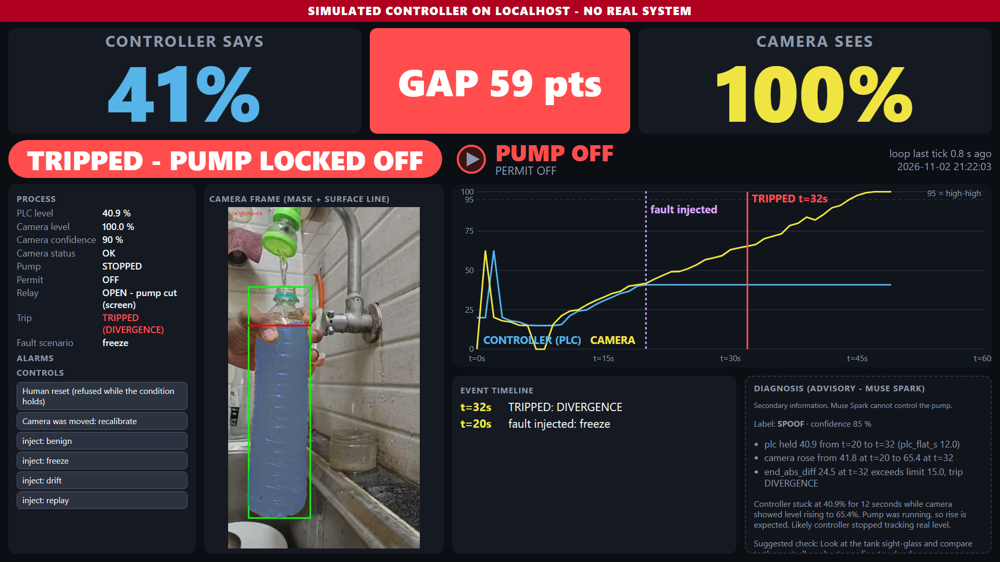

SightGlass uses a phone camera and Meta SAM 3.1 as an independent witness of a tank's level. When the controller's reported level and the camera disagree, a fixed safety rule latches the pump off. Muse Spark then explains what probably happened, as advice to a person.



Everything here runs against a **simulated** controller on 127.0.0.1. No real pump, tank or PLC is connected. The camera footage and the SAM readings are real (a hand-held bottle of orange liquid, filmed on a phone). The tank, the PLC, the Modbus link and the injected faults are simulated.

Entry for the Meta Global AI Developer Hackathon, Indie track. All code was written between 27 Oct and 4 Nov 2026.

## Why

Small workshops and overhead tanks often rely on one float switch or one level transmitter. If that one reading lies, nothing notices. It can be stuck, drifting, replayed from old values or tampered with. The pump keeps running and the tank overflows.

A camera is a cheap second opinion. It does not share the controller's failure modes: a frozen PLC register does not freeze a camera image. SightGlass compares the two numbers and trips only when they disagree for long enough.

## Safety design

This is the core of the project. The camera is allowed to do one thing: remove pump time.

- **The camera can only turn the pump off.** `interlock.step()` is a pure function. It cannot emit "permit on". Only a human reset can (`src/agentwarden/interlock.py`, module docstring).
- **A trip latches.** After a trip the permit stays off until a person resets it, and the reset is refused while the trip condition still holds.
- **Re-arming needs a single-use `ResetGrant`.** `reset_with_grant()` mints it, `redeem()` spends it once, and only `permit.py` redeems it.
- **On the simulated Modbus wire, the permit coil cannot be written True.** The server refuses any True write to it (FC5 and FC15). A test sends raw writes and checks that the permit does not change.
- **A blind or occluded camera never trips.** No reading means no verdict. The interlock raises `CAMERA_UNVERIFIED` as an alarm and clears its mismatch timers. A hand in front of the bottle is detected with a SAM "hand" concept and shown as `OCCLUDED`. The dashboard says "CAMERA BLOCKED - NO TRIP".
- **Muse Spark is advisory.** The diagnoser and the advisor modules cannot reach the pump. Static tests walk the import graph and the call names and fail if either module can reach permit, interlock, reset, relay, Modbus writes or the fault injector (`tests/test_s5.py`, the `test_static_*` tests, and `tests/test_open_spark.py::test_open_spark_has_no_path_to_actuation`). The dashboard card says "Muse Spark cannot control the pump".
- **Closed-loop property test.** Over 1,000 seeds, with and without the interlock, the pump is never on with the interlock when it would be off without it, and the permit never goes from off to on without an accepted human reset (`tests/test_s3fix.py::test_closed_loop_interlock_only_removes_pump_time`). In that test 631 seeds trip and 273 re-arm (`runs/S4fix_summary.md`, not in this repo), so the property is not checked only on trivial runs.

### Threat model

Honest version.

- The dashboard token is a drive-by (CSRF) control, not authentication. `GET /` hands it to any local process, and a token holder is treated as the human. Another process on the same machine can read it, and can reach the simulated Modbus port too. This is a localhost demo. It is not a defence against a hostile local user.
- The server binds 127.0.0.1 only, checks Host, Origin and Sec-Fetch-Site, and sends a CSP. Those stop a web page in your browser from driving it. They do not stop a local user.
- A camera that goes blind first and is spoofed afterwards is not detected. The interlock only raises an alarm. We measured it: PLC frozen at 15.6 %, hidden camera level 100 %, an 84.4 point gap, no trip (`eval/RESULTS.md` section 5).
- In replay, the plant follows the recording, so "no overflow" is true by construction there. The claim we make is "tripped before the camera reached 95 %".
- The relay driver for a USB relay board (`src/agentwarden/relay.py`, `UsbSerialRelay`) is untested hardware. Its frames are assumed.

### ResetGrant limits

> ResetGrant is an in-process capability, not a security boundary. It stops accidents and static-analysis-visible misuse (no copy, no pickle, single use, only interlock.py mints); it cannot stop deliberate reflection inside the same Python process. The enforced guarantee is on the Modbus wire: the permit coil cannot be written True.

## Meta models used

| Model | What for | Request shape | Where |
|---|---|---|---|
| SAM 3.1 (`sam-3.1`) | Concept segmentation, one image per call. Three concepts per frame: "orange liquid", "plastic bottle", and "hand" for occlusion. | `POST /responses`, `input_text` (the concept) plus `input_image`, metadata `mask_encoding: one_bit`, `include_confidence: true` | Client: `src/agentwarden/meta.py:113` (`sam_image`). Calls: `src/agentwarden/vision.py:58` (liquid), `:59` (container), `:66` (hand). Concepts: `vision.py:27-28`. |
| Muse Spark (`muse-spark-1.3`, hosted) | Advisory diagnoser: reads a 120 s incident window and returns a JSON label, evidence, a note and a suggested check. | `POST /responses`, `input` text, `text.format` json_schema (non-strict), `max_output_tokens` 8192 | Client: `src/agentwarden/meta.py:127` (`spark_json`). Calls: `src/agentwarden/diagnoser.py:341` and `:344` (at most two per incident). |
| Muse Spark Open (`meta-models/muse-spark-open`, via Baseten) | The same diagnoser on open weights. | OpenAI-style `/chat/completions`, `response_format: json_object`, schema in the prompt, `max_tokens` 8192 | `src/agentwarden/open_spark.py:54` (body), `:63` (`spark_json`). Recorded runs: `demo/real/open_spark_runs.json`. |

SAM reads the level. It never decides anything. The level estimator turns the liquid mask and the bottle box into a percentage, and the interlock compares that with the PLC number. Details of what each model did and what went wrong are in [BUILT_WITH_META.md](BUILT_WITH_META.md).

## Results

All numbers are from `eval/results.json` and `eval/RESULTS.md`, produced by `uv run python -m agentwarden.evaluate --out eval`. The run is deterministic. Detection and false-alarm numbers use a simulated tank and a simulated gaussian camera (sigma = 3 points), not real footage.

| Question | Result | Source section |
|---|---|---|
| Does it catch a lying controller? | Freeze (offsets 0 to 20 points), drift (0.03 to 1.0 points/s) and replay: 200/200 seeds caught in every setting tested. Step of 10 points: 198/200. Step of 5 points: 0/200, and none of those overflowed (5 is below the 15 point threshold). Overflow reached in 0 seeds. | RESULTS section 2 |
| How fast? | Median time to trip: 1 s (freeze, 20 point offset) to 14 s (freeze, 0 offset); 11 to 77 s for drift of 1.0 to 0.2 points/s; 147 to 450 s for slow drift of 0.1 to 0.03 points/s. | section 2 |
| False alarms | 0 false trips in 100.0 hours of simulated benign running. Upper 95 % bound 0.030 per hour (rule of three). Gaussian noise only; real readings have outliers. | section 3 |
| Real footage replay | With a fault injected on the PLC side of a real recorded pour, the interlock tripped before the camera reached 95 % in 7 of 9 runs. The two misses are drift runs that tripped on HIGH_HIGH at t = 46 s, one second after 95. | section 4 |
| Camera blocked by a hand | On a 22-frame clip with a full bottle, the old code kept 21 frames as "OK" and was up to 88.6 points off. After the occlusion check the 6 remaining OK frames are 0.0 points off, and 16 frames are `OCCLUDED`. With a 2 s mismatch timer, false trips went from 1 to 0. | section 8 |
| Lights off | 11 dark frames are `CAMERA_BLIND`: alarm, no trip. Readings return to 100 % when the light returns. | section 8 |
| Muse Spark diagnoser | 6 recorded incidents replayed from the cassette: 6/6 grounded (every quoted number is in the data), 6/6 labelled SPOOF, 6/6 agree with the rule label. | section 6 |
| Muse Spark Open | 3/3 labelled SPOOF on the recorded runs (`demo/real/open_spark_runs.json`). | file named in the row |
| SAM against a colour threshold | On the same 54 frames and the same container box: SAM had 1 backward step (largest 1.8 points). A colour threshold had 3 (largest 7.9). Median frame-to-frame noise was about the same (1.20 and 1.16). One clip only. | section 7 |
| Level against still photos | Mean absolute difference 0.2 points, largest 0.4, over 7 photos. The reference levels were eyeballed, so this is agreement, not accuracy. | section 1 |

The test suite had 473 passing tests at the last full run (`runs/S6b_summary.md`, not in this repo).

### Limits

- No tape or scale ground truth. Level quality uses a "a steady pour never goes down" proxy and eyeballed reference levels. We claim no accuracy figure.
- Real footage is one bottle, one orange liquid, one hand-held pour (54 frames), plus two short clips (22 and 27 frames) for the hand and the lights. Other occluders (a sleeve, a cloth) and partial shadows are untested.
- The occlusion check adds a third SAM image call per frame, a 50 % increase in image cost over two calls. A hand covering less than 20 % of the bottle is not caught by it; only an 8 points/s plausibility guard applies there.
- The 15 point trip threshold is a provisional default. It was not derived from a measured error distribution.
- The PLC, the tank and the injected faults are simulated. Detection and false-alarm numbers describe the rules against a gaussian fake camera.
- The blind-then-spoof gap described in the threat model is a documented limit.
- The model results come from a handful of recorded calls. That is far too few to quote rates.
- The rule baseline for the diagnoser (74.0 % overall on 200 synthetic incidents per class) was written by the same author as the rule, so it is an optimistic ceiling.
- Live SAM from a phone is not wired into the command line (see Live mode). The live camera path exists as library code and has not been run end to end in this repo.
- `UsbSerialRelay` is untested hardware.

## Quick start (keyless, offline)

No API key and no network are needed. You need Python 3.11 or newer and [uv](https://docs.astral.sh/uv/).

```
uv sync
uv run pytest -q
```

Replay the recorded pour with a frozen controller and recorded Muse Spark diagnoses:

```
uv run python -m agentwarden.web --replay demo/real/pour_replay.json --scenario freeze --fault-start 20 --start-at 12 --loop --diagnoser cassette:demo/real/spark_cassette
```

Open http://127.0.0.1:8765/ in a 1920x1080 window. The frames are found in `demo/real/pour_frames` automatically. Add `--pace 0.5` to run faster.

Other takes:

```
# hand in front of the bottle: CAMERA BLOCKED - NO TRIP
uv run python -m agentwarden.web --replay demo/real/hand_replay.json --frames demo/real/hand_frames --hh-limit 101

# room light off: CAMERA BLOCKED - NO TRIP
uv run python -m agentwarden.web --replay demo/real/lights_replay.json --frames demo/real/lights_frames --hh-limit 101
```

`--hh-limit 101` switches the high-high rule off for those two clips, because the bottle in them really is full and a trip would be correct. Other scenarios are `benign`, `drift` and `replay`. A fault can also be injected from the dashboard, and the reset button is the human reset.

Rerun the evaluation (about 20 to 30 seconds):

```
uv run python -m agentwarden.evaluate --out eval
```

### Live mode

- **Live Muse Spark diagnoser.** Put the key in a file and pass the file, never an environment variable: `--diagnoser live --key-file PATH --base-url URL`. The key is read only from that file and is not logged (a test checks this). `--base-url` has no default. Spend is capped at 1 USD per process.
- **Phone camera.** `--source http:http://PHONE_IP:8080/shot.jpg` reads single shots from an IP-webcam style app (`--cam-user` and `--cam-password` for basic auth). The host must be loopback or a private address. Credentials in the URL are refused.
- **What is not wired.** The command line does not call SAM live. `build_vision` in `src/agentwarden/pipeline.py` takes a recorded readings file or a cassette of recorded SAM responses. Live SAM exists as `LiveVision(MetaClient(...))` in the library and was used to record the clips in `demo/real`, but there is no flag for it. The live Spark path was used to record the cassettes in `demo/real/spark_cassette`.

## Open-weights path

The same diagnoser also runs on Muse Spark Open, hosted by Baseten, model id `meta-models/muse-spark-open`. The code is `src/agentwarden/open_spark.py`.

- **Model id.** The id in the guide we followed ended in "-1026" and returned HTTP 404. The working id is `meta-models/muse-spark-open`.
- **How it was recorded.** `OpenSparkClient` was run in record mode with a Baseten key on the freeze, drift and replay incidents (fault start 20). Each request and response is stored under its request hash in `demo/real/open_spark_cassette/` (3 files). The readable summary is `demo/real/open_spark_runs.json`: label, confidence, evidence lines, note and suggested check for each run.
- **How to replay.** Replay needs no key: `OpenSparkClient(None, "demo/real/open_spark_cassette", "replay")` returns the stored response for a matching request and raises on a miss. `tests/test_open_spark.py` shows the record and replay round trip. Run it with `uv run pytest tests/test_open_spark.py -q`. There is no dashboard flag for the open path.
- **Same limits.** It is advisory only. Its output goes to the dashboard card and nowhere else.

## Architecture

```
 phone camera --> SAM 3.1 --> level estimator --> interlock <-- PLC level (simulated)
 (frames)         (masks)     (camera %)          (fixed rule)   (Modbus, 127.0.0.1)
                                                      |
                                                      v
                                              pump permit (off only)
                                                      |
                                                      v
                                             simulated pump / relay

 incident window (PLC series, camera series, alarms)
        |
        v
   Muse Spark  --> diagnosis card on the dashboard  (advice to a person, no other output)
```

Two numbers go into the interlock: the PLC level and the camera level. It trips on any of three rules: the two differ by more than T points for N seconds (divergence), the camera sees a rise the PLC does not echo (rate), or the camera alone sees 95 % or more in two consecutive frames (high-high). Divergence is symmetric: a camera below the PLC also trips. The trip latches. The permit is derived from the trip state and goes to the simulated Modbus server and, optionally, a relay driver. Spark reads a copy of the data after a trip and writes text for the dashboard.

## Built in-event

Dates are from `git log`.

| Date | Work |
|---|---|
| 27 Oct 2026 | Bootstrap, spend ledger and request cassettes (C0). Meta API client with per-image pricing (S1a). SAM output parser and liquid level estimator (S1b). Size checks, container and liquid selection, glare handling (S1c). |
| 28 Oct 2026 | Fixtures from real SAM 3.1 responses of a live smoke test. |
| 2 Nov 2026 | Simulated tank, PLC, Modbus link, fault injector and interlock (S3). Camera sources, vision, pipeline and dashboard (S4). Muse Spark diagnoser and relay driver (S5). Permit hardening and the closed-loop safety test (S3fix). Dashboard hardening (S4fix). Real pour frames and SAM readings recorded. Spark output cap raised to 8192 tokens. |
| 3 Nov 2026 | Offline evaluation (S6). Open-weights path on Muse Spark Open. Occlusion and lighting checks (S6b). Real still-photo readings. Documentation and submission text (S7). |

## AI assistance

This project was built with Claude Code (Anthropic) as the coding assistant. I designed the system, wrote the specifications, reviewed every chunk and directed the work. The assistant wrote most of the code from those specifications, with tests committed first and failing, then the code that made them pass. See [docs/AI_ASSISTANTS.md](docs/AI_ASSISTANTS.md). Third-party code is listed in [THIRD_PARTY.md](THIRD_PARTY.md).

## License

MIT. See [LICENSE](LICENSE).
